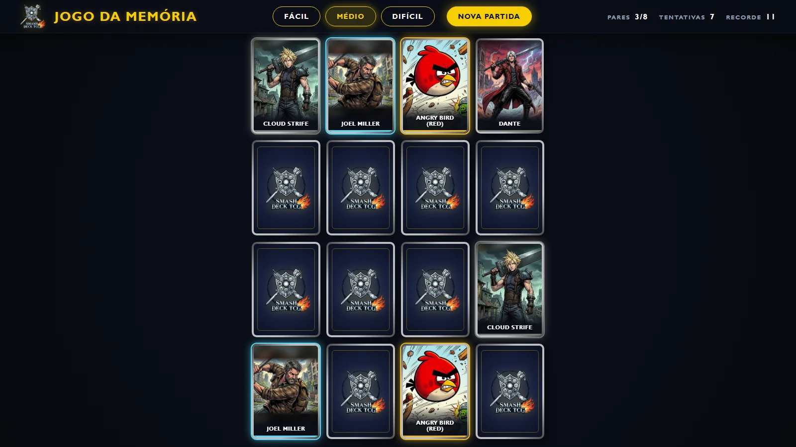

# Jogo da Memória | Smash Deck TCG

Minijogo oficial do [Smash Deck TCG](https://smashdecktcg.netlify.app), o jogo de cartas autoral com as lendas dos games. Encontre os pares de lendas no menor número de tentativas.

**[Jogar agora](https://smashdecktcg-memoria.netlify.app)**




---

## Sobre o projeto

A primeira versão era um jogo da memória simples, com emojis. Nesta versão, ele virou uma página do universo do Smash Deck TCG, com a mesma identidade visual do site: paleta, fundo escuro, botões dourados, borda metálica das cartas e a logo oficial.

O projeto continua com HTML, CSS e JavaScript puro, sem frameworks nem bibliotecas.

## Funcionalidades

- **As 103 lendas e o Olvido:** a cada partida o jogo sorteia as lendas da mesa, então nenhuma partida é igual.
- **Três dificuldades:** Fácil (4x3), Médio (4x4) e Difícil (6x4).
- **Recorde:** o menor número de tentativas fica salvo no `localStorage`, separado por dificuldade.
- **Cartas colecionáveis:** verso com a logo e frente com a arte da lenda e o nome na cor da classe.
- **Virada 3D:** a carta gira com `rotateY`, como as cartas do site.
- **Inclinação e brilho holográfico:** com o mouse por cima, a carta inclina em 3D e um brilho arco-íris acompanha o cursor.
- **Sem rolagem:** o tabuleiro se ajusta ao espaço da tela, no computador (16:9) e no celular. No celular em pé, a grade gira (o Difícil vira 4x6).
- **Teclado:** as cartas são botões, então dá para jogar com Tab, Enter e Espaço.

## Decisões técnicas

- **Embaralhamento Fisher-Yates:** percorre a lista de trás para frente e troca cada item com outro de posição aleatória. O `sort(() => Math.random() - 0.5)` da versão antiga não sorteia de forma justa.
- **Tamanho das cartas com unidades de container:** a área do tabuleiro é um container (`container-type: size`). A largura da carta é o menor valor entre "cabe na largura" e "cabe na altura", calculado só com CSS (`cqw`, `cqh` e `min()`).
- **Enquadramento por lenda:** as artes são horizontais e a carta é em pé. Cada lenda tem um `foco` (onde fica o meio do personagem na arte) e um `zoom` (tamanho da arte na carta), para o personagem aparecer inteiro e centralizado. O espaço que sobra é preenchido pela mesma arte desfocada.
- **Janela de vitória com `<dialog>`:** o próprio navegador cuida do foco e da tecla Esc.

## Estrutura

```
index.html
css/estilo.css     estilos, paleta e efeitos das cartas
js/jogo.js         lendas, sorteio, regras e recorde
imagens/marca/     logo e favicon do Smash Deck TCG
imagens/artes/     artes das lendas
fontes/            Lora itálico (frase de vitória) e licença
docs/              imagem deste README
```

## Como rodar

O jogo está publicado no Netlify: [smashdecktcg-memoria.netlify.app](https://smashdecktcg-memoria.netlify.app). Para rodar no seu computador:

1. Clone o repositório:
   ```bash
   git clone https://github.com/gustavomenacho/Memory-Game.git
   ```
2. Abra o `index.html` no navegador. Não precisa instalar nada.

## Uso de IA

Este projeto foi desenvolvido com apoio de ferramentas de IA, para revisão de código, explicações e parte das artes das lendas, que vêm do Smash Deck TCG. As decisões de design e o conteúdo são meus.

## Aviso legal

**Projeto de fã, estritamente não comercial e educacional.** Os personagens pertencem aos seus respectivos detentores. A fonte Lora é distribuída sob a SIL Open Font License 1.1 (ver `fontes/LEIA-ME.txt`).

## Autor

**Gustavo Menacho**: advogado em transição para o desenvolvimento front-end.

[](https://www.linkedin.com/in/gustavomenacho/)
[](https://github.com/gustavomenacho)
